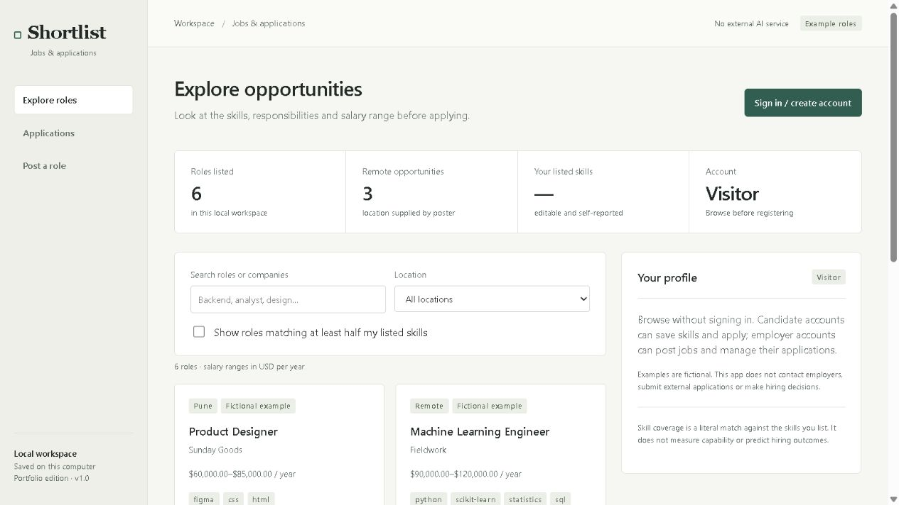

# Shortlist — Jobs & applications

Skills-based job discovery, applications and employer workflows.

## Run locally

Requires Python 3.11+. Run from this project folder:

    py -m venv .venv
    .venv\Scripts\python.exe -m pip install -r requirements.txt
    .venv\Scripts\python.exe run.py

Open http://127.0.0.1:8904. On macOS/Linux use python3 and .venv/bin/python instead. Install requirements-dev.txt and run python -m pytest -q for tests.

## Data and access

Runs on loopback. This is a local portfolio application, not a configured production service. SQLite and generated model files live in ignored data/; back up that folder. APP_DATA_DIR selects another data location. Public source contains no personal data or credentials. Demo data is synthetic and labeled. Imports stay on the local server. No paid AI API is used. HTTPS, deployment authentication and operational monitoring must be added before remote exposure.

## Accounts and workflows

Six fictional job examples are visible without sign-in. Register a local candidate or employer account with a unique username and a 12+ character password. Passwords use salted scrypt; session tokens are random, stored as hashes and expire after 24 hours. Cookies are HttpOnly and SameSite Strict; Secure is intentionally off for local HTTP. Production deployment needs HTTPS/Secure cookies and a broader authentication review. Failed login attempts are limited in process memory.

Candidates can save self-reported skills, parse TXT/text-based PDF resumes, apply once per role and withdraw active applications. Resume extraction recognizes a fixed vocabulary by literal token matching; it cannot understand negation or infer proficiency. Parsing does not save until the candidate reviews and submits their profile. The raw resume is not retained. Skill coverage explains matched/missing labels and is a candidate discovery aid, not an employment eligibility or ranking decision.

Employers can post roles and see only applications to their own jobs. Status transitions are constrained: Received → Reviewing → Interview → Offered, with rejection before offer. Candidate withdrawal and employer updates enforce ownership. Example applications are local demonstrations and never contact real organizations. Employer accounts are self-registered for this local portfolio app; no organization verification or email delivery exists.

APIs: GET /api/state, /api/applications; POST /api/register, /api/login, /api/logout, /api/profile, /api/resume, /api/jobs, /api/jobs/{id}/apply, /api/applications/{id}.

## Interface preview

## Validation

Automated tests cover the local HTTP boundary and project-specific workflows. Browser checks cover the rendered interface and primary interactions. Dependency versions used for validation are pinned in constraints.txt. The screenshots show synthetic/example data, not customer information.
